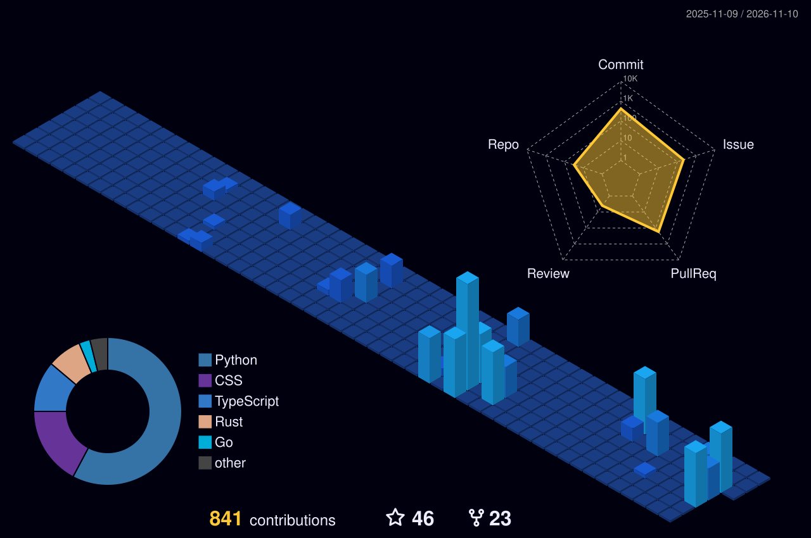

<!-- Header Banner -->

<!-- Dynamic Animated Typist -->

  
  
  
  

---

### ⚡ Engineering Focus & Architecture

I build high-throughput distributed systems, financial exchange engines, and low-latency infrastructure. My work emphasizes lock-free data structures, deterministic event-time stream processing, and mechanical sympathy across hardware, compilers, and networks.

* 🎓 **University of Denver**: Pursuing B.S. in Computer Science • Treasurer of **DU AI Club**
* ⚙️ **Core Focus**: Low-latency matching engines (C++20), real-time streaming (Kafka/Spark), transactional ledgers (Go), and async workers (Rust)
* ♟️ **Passions**: Competitive Chess (1600+ ELO), algorithmic problem solving, and WebGL graphics engines

---

### 🎏 The Living Canvas · Generative Git Automations

> Visualizing development activity into real-time algorithmic art, updated automatically via GitHub Actions workflows:

<table align="center" width="100%">
  <thead>
    <tr>
      <th width="45%" align="center">🎏 Daily Activity Koi Pond</th>
      <th width="55%" align="center">🐍 Contribution Matrix Snake</th>
    </tr>
  </thead>
  <tbody>
    <tr>
      <td align="center" valign="middle">
         
        
         
        <b>Algorithmic Koi Pond</b>: Pixel-art koi swimming in real-time based on daily commit telemetry (<code>yalongwastaken/git-koi</code>).
      </td>
      <td align="center" valign="middle">
         
        <picture>
          <source media="(prefers-color-scheme: dark)" srcset="./dist/github-snake-dark.svg">
          <source media="(prefers-color-scheme: light)" srcset="./dist/github-snake.svg">
          
        </picture>
         
        <b>Arcade Snake</b>: Traverses the contribution commit grid eating commits like pellets (<code>Platane/snk</code>).
      </td>
    </tr>
  </tbody>
</table>

#### 🏙️ 3D Isometric Git Skyline

  <picture>
    <source media="(prefers-color-scheme: dark)" srcset="./profile-3d-contrib/profile-night-view.svg">
    <source media="(prefers-color-scheme: light)" srcset="./profile-3d-contrib/profile-green-animate.svg">
    
  </picture>

---

### ⚡ Selected Systems & Open Source Architecture

| System | Architecture & Implementation | Stack |
| :--- | :--- | :---: |
| [**cpp-limit-order-book**](https://github.com/maddoxk/cpp-limit-order-book) | High-performance C++20 limit order book & matching engine featuring ITCH-style binary feed parsing, lock-free SPSC ring buffers, and benchmarked zero-allocation critical path. | `C++20` `Benchmarking` `Low-Latency` |
| [**streaming-trade-pipeline**](https://github.com/maddoxk/streaming-trade-pipeline) | Production-grade real-time Binance trade pipeline: Apache Kafka ingest &rarr; Apache Spark Structured Streaming with watermarked event-time windows &rarr; Idempotent PostgreSQL upserts. | `Python` `Kafka` `Spark` `Postgres` |
| [**fintech-payments-ledger**](https://github.com/maddoxk/fintech-payments-ledger) | Enterprise double-entry financial ledger core with finite state machine payment lifecycle, idempotent execution, ISO-20022 schema modeling, multi-currency integer minor units, and automated reconciliation. | `Go` `SQLite` `Fintech` `ISO-20022` |
| [**Chain-Market-Price**](https://github.com/maddoxk/Chain-Market-Price) | Ultra-low latency DeFi/crypto market data and mempool streaming engine engineered for high-throughput websocket broadcast. | `Rust` `Tokio` `Async` `WebSockets` |
| [**network-health-monitor**](https://github.com/maddoxk/network-health-monitor) | Async network probe engine (ICMP/TCP/DNS/HTTP/TLS) exporting real-time Prometheus metrics with Grafana observability dashboard. | `Python` `Prometheus` `Grafana` `Docker` |
| [**maddoxk.github.io**](https://github.com/maddoxk/maddoxk.github.io) | Personal cyberpunk/neon portfolio featuring custom Three.js WebGL shaders, Bayer matrix plasma dithering, variable font axes, and GLSL ASCII filter text. | `TypeScript` `Three.js` `React` `Tailwind` |

---

### 🛠️ Technical Ecosystem

#### Systems, Concurrency & Core

 

#### Data Streaming, Infrastructure & DevOps

 

#### Frontend, Graphics & WebGL

---

### 📊 Telemetry & Contribution Analytics

<table border="0">
  <tr>
    <td align="center" width="50%" valign="top">
      
    </td>
    <td align="center" width="50%" valign="top">
      
    </td>
  </tr>
  <tr>
    <td colspan="2" align="center">
      
    </td>
  </tr>
</table>

---

### ⚡ Recent Public Activity

<!--START_SECTION:activity-->
1. 🔒 Closed issue [#11](https://github.com/maddoxk/cpp-limit-order-book/issues/11) in [maddoxk/cpp-limit-order-book](https://github.com/maddoxk/cpp-limit-order-book)
2. 🎉 Merged PR [#12](https://github.com/maddoxk/cpp-limit-order-book/pull/12) in [maddoxk/cpp-limit-order-book](https://github.com/maddoxk/cpp-limit-order-book)
3. 🔒 Closed issue [#50](https://github.com/maddoxk/Chain-Market-Price/issues/50) in [maddoxk/Chain-Market-Price](https://github.com/maddoxk/Chain-Market-Price)
4. 🗣 Commented on [#50](https://github.com/maddoxk/Chain-Market-Price/issues/50#issuecomment-6608406465) in [maddoxk/Chain-Market-Price](https://github.com/maddoxk/Chain-Market-Price)
5. 🗣 Commented on [#7](https://github.com/maddoxk/cpp-limit-order-book/issues/7#issuecomment-6608404823) in [maddoxk/cpp-limit-order-book](https://github.com/maddoxk/cpp-limit-order-book)
<!--END_SECTION:activity-->

---

Designed with precision & aesthetic craft • Powered by GitHub Actions

